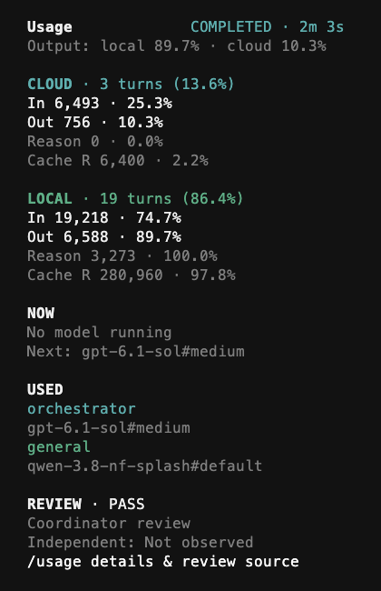
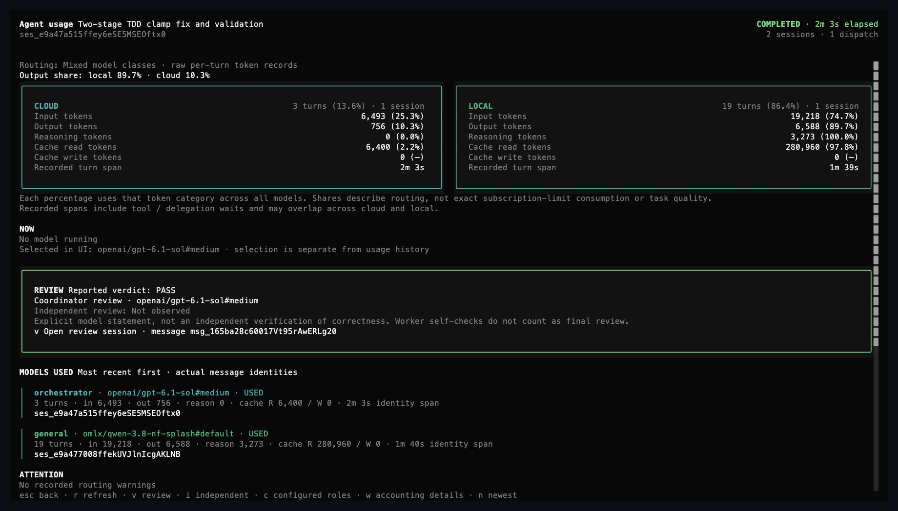

# Native OpenCode agent setup

OpenCode CLI 2.1.2 was installed with Homebrew. This standalone terminal wizard writes native OpenCode configuration; it does not install OMO or patch OpenCode binaries. Existing ports and server settings are preserved.

Run from your project directory:

```sh
opencode-agent-setup
```

Choose global/project scope, optionally add a custom Orchestrator and cloud reviewer, connect providers, and select each agent's model and supported reasoning variant. Provider setup can be repeated before continuing, so OpenAI and local Qwen can be configured in one wizard. Each agent step explains its role, permissions, and recommendation. You can go back to the previous agent, retain instructions, apply a minimal enhancement, restore the native agent system text, or edit custom text. The final review displays configuration changes and exact agent prompt diffs. Nothing is saved until confirmation. Ctrl-C cancels pending wizard choices; a completed native provider login is a separate persisted action.

The recommended mixed profile uses OpenAI Sol for planning, coordination and final review. Local Qwen executes bounded implementation, tests and discovery; it does not own planning or review judgment. The cloud coordinator delegates dependent stages to one local worker, then reviews the patches and test evidence in the same cloud session. Difficult implementation can escalate to cloud Build; a separate cloud reviewer is available when independent review is needed. Model IDs and variants come from the authenticated OpenCode inventory. The reusable choices are in `examples/mixed-workers.json`; recommendations do not silently replace saved selections. The [activated balanced profile](docs/balanced-profile.md) uses Sol medium for planning/coordination, Sol high for hard implementation/independent review, and Standard-speed requests; Luna remains an unvalidated candidate.

For local setup, reuse the existing oMLX key, read an environment variable, or select a private key file. The wizard authenticates discovery against the existing endpoint, then previews a reference to a private credential file. That file is created with mode 0600 only after confirmation; its directory is mode 0700. Native OpenCode validates the reference and authenticates local discovery again. Credentials never appear in generated JSON or terminal diffs. No shared-service restart or port change is needed. Reset/undo preserve credentials, just as they preserve native OpenCode authentication.

The local model discovered during testing was `omlx/qwen-3.8-nf-splash`. Provider setup declares 262144 context and 8192 output tokens; this tool's small functional tests do not establish 256K reliability or a concurrency limit.

## Agents

Build and Plan remain native primary agents; General and Explore remain native subagents. Compaction, Title and Summary are hidden system agents. This release does not expose the documented Scout agent, so the wizard does not fabricate it. Orchestrator and cloud-reviewer are optional custom roles, labelled as such.

The custom coordinator has an eight-step budget, edit and shell tools denied; it delegates implementation/tests and reviews evidence. The reviewer has read/research access and cannot edit, run shell commands or delegate. Cloud Build and reviewer dispatch remain allowed; the coordinator uses them when evidence or review independence warrants the extra cloud session. Cloud models are not disabled or blocked by the mixed profile. General's enhanced profile has a 24-step limit and no nested delegation. Explore's enhanced profile retains its exact native system text and adds concise reporting, with a 12-step limit. Plan's optional enhanced profile denies shell/source edits and can delegate only to Explore. Foreground test dispatch, bounded scopes and concise summaries are prompt policies, not a hard scheduler or global queue.

Native model defaults can be overridden by explicit session/UI model selection. Enhancing an existing custom role is an explicit replacement of its role permissions and text; choosing keep-current preserves them. Hidden-agent prompts are left unchanged.

## Inspect, preview, undo and defaults

```sh
opencode-agent-setup inspect
opencode-agent-setup preview --choices examples/local-workers.json
opencode-agent-setup undo
opencode-agent-setup reset
```

`preview` works offline and does not validate model availability or invoke models. Paths in these examples are relative to this tool's source directory. `apply --choices FILE` checks models against the current inventory before presenting confirmation. `--config /absolute/path/opencode.jsonc` selects a particular target. `--dry-run` previews without saving; `--yes` explicitly authorizes unattended apply/reset/undo.

Undo restores the last tool transaction, even when OpenCode is missing or has upgraded to an unsupported version. Recovery reports explicitly whether native validation ran; a restored file alone does not establish the effective runtime settings. Inherited Markdown and server-expanded environment/file references can prevent complete native restoration validation; this is reported explicitly while preserving the restored file. Concurrent changes detected during undo validation are preserved and the recovery journal is retained. If unrelated settings changed later, it preserves them; changes to owned fields cause a conflict instead of overwriting user work. Exact original bytes are restored when the file has not otherwise changed. Newly created configuration files are removed on undo. Repeated identical apply does not create a second transaction.

Reset removes built-in agent overrides from the selected JSON/JSONC file and offers removal of the optional custom roles. It preserves providers, credentials and unrelated settings. Agent Markdown files, other projects, environment overrides and managed settings are reported but never silently deleted. A reset applies to the selected scope; it cannot promise factory defaults across every external configuration source.

Private recovery history and local credential files live under `$XDG_STATE_HOME/opencode-agent-setup` or `~/.local/state/opencode-agent-setup`. A writer lock prevents two cooperating patchers from writing the same target. If a process is killed, inspect its `.agent-setup.lock` before removing it; unfinished transactions can be recovered with undo. Close editors while applying to avoid uncooperative writer races.

The tool supports the examined 2.1.2 schema. Unknown versions permit inspection and journal-based undo; apply/reset remain disabled. It checks decoded config and effective agent fields, rejecting shadowed prompts and unavailable models. Use fresh OpenCode sessions after prompt/permission changes. Validation is performed for the selected configuration directory; other projects may have higher-priority settings.

## Verification

```sh
npm test
RUN_NATIVE_TESTS=1 RUN_LOCAL_TESTS=1 OPENCODE_PLUGIN_TESTS=1 npm test
python3 test/terminal.py
OPENCODE_COMPLETION_TESTS=1 node --test test/plugin-completion.test.js # explicit local inference
python3 scripts/live-local-smoke.py
python3 scripts/live-local-smoke.py --coordinator
```

The explicit local smoke scripts use oMLX's current key and endpoint and make local inference requests. They create disposable fixture projects, temporarily store the key in a private file, and delete that key file on exit. They do not run your project's macOS suite. `--coordinator` uses local Qwen for the test coordinator as well as the worker, so it tests native delegation without spending cloud tokens. It is not evidence of authenticated OpenAI routing.

See `docs/test-report.md` for the observed results and limitations. Prompt wording is centralized in `src/prompts.js`; `artifacts/all-agent-prompt-changes.diff` shows every optional role enhancement, and `artifacts/prompt-changes.diff` shows the local-worker example. Native baseline text is captured in `data/builtin-2.1.2.json` from the unmodified runtime. OMO was consulted for delegation principles only; no OMO prompt text, package or scheduler is installed.

The launcher is installed using `npm link --ignore-scripts` and points to this source directory. Keep the directory to retain the command. Dependencies are locked in `package-lock.json`; Node 24 was used for verification.

## Stage commits and self-checks

The enhanced profiles now require a verified commit after each completed implementation task or planned stage. Implementers inspect Git state before editing, diagnose the root cause, run required checks and inspect their diff against acceptance criteria before committing. Final reports include STATUS, CHECKS, SELF_CHECK and COMMIT evidence. A failed or blocked required check is not completion, and test-only/read-only work does not need an empty commit.

User work is protected conservatively: any unrelated staged change or existing edit to an owned file requires NEEDS_CONTEXT before editing. Pathspec commits are not an exception. Shared-checkout writers run sequentially; parallel writing requires separate worktrees. No automatic pushes, amends, resets, Git identity changes or repository initialization are permitted without authorization.

Orchestrator can call the enhanced OpenAI Build agent for hard fixes. Build uses `mode: all`, so it remains selectable as a primary agent. A child Build executes the assigned task itself and must not delegate back to the coordinator. The coordinator batches dependent stages with unchanged ownership into one local worker assignment, preserving separate verified commits and reviewing final evidence once; risky changes can receive independent cloud review. Detailed exact templates are in `src/prompts.js`.

Explicit live checks (make local/cloud inference requests):

```sh
python3 scripts/stage-commit-smoke.py
python3 scripts/verify-stage-result.py artifacts/stage-commit-result.json
python3 scripts/staged-conflict-smoke.py /absolute/path/to/the/stage-smoke-repo
```

See the revised section of `docs/test-report.md` for mixed-model commits, independent validation and the staged-user-work negative test. Prompt instructions improve discipline but are not hard runtime enforcement; commits provide audit/rollback checkpoints, not proof of correctness.

## Usage report: tokens, models, agents

```sh
opencode-agent-setup usage                      # most recently updated root session in the current directory
opencode-agent-setup usage --list               # recent root sessions here, with IDs
opencode-agent-setup usage --session ID         # a specific session and all its child sessions
opencode-agent-setup usage --session A --compare B
opencode-agent-setup usage --json --pricing pricing.json
```

The report reads OpenCode's own session database (`~/.local/share/opencode/opencode.db`) read-only. It needs no running service, makes no model requests and writes nothing. For the root session and every descendant it shows agent, model, provider class (local, cloud or unknown), turns, input/output/reasoning/cache tokens, a weighted total, estimated cost when known, and wall-clock span; then totals by class, agent and model; the subagent dispatches with foreground/background mode; possible General-to-Build handoffs; descriptive routing status; and findings with concrete suggestions. Usage is attributed to each message’s agent and model, so switching either within a session does not move earlier usage. Separate compaction records and native error records are included. Mixed sessions expose their individual agent/model contributions.

Weighted tokens count input, output, reasoning and cache writes in full and cache reads at ten percent, as a fixed heuristic. Provider discounts vary; this metric is not a bill or a measure of task quality. Cost is shown only when OpenCode recorded one or when `--pricing FILE` supplies per-million rates such as `{"openai/gpt-6.1-sol":{"input":2,"output":8,"cacheRead":0.2}}`; otherwise the report says unpriced.

Findings describe observed routing and token volume: cloud worker usage, background dispatches, coordinator volume relative to children, possible General-to-Build handoffs, nested delegation, reasoning-heavy turns, compaction, step budgets, errors and unpriced models. A handoff does not prove the local worker failed or work was duplicated. Routing status reports local-only, cloud-only, mixed or unknown usage; it does not grade efficiency or claim savings. Provider classification uses explicit provider IDs rather than name prefixes; unknown providers stay unknown. Tool parts repeated in later turns are deduplicated so each dispatch is counted once.

Run `usage` after a session ends, in the project directory. Compare the same accepted outcome through Orchestrator plus local workers and through Build alone (`scripts/build-only-baseline.py` after `scripts/stage-commit-smoke.py`). The baseline verifier requires four passing tests, two commits with the specified file scopes, a clean worktree and no delegation. Use repeated representative tasks to assess absolute cloud usage, pricing where known, latency, retries and human intervention. A lower cloud percentage alone cannot establish savings. The [cloud-led matched comparison](docs/cloud-led-comparison.md) records the corrected role split and fresh measurements. The [all-local experiment](docs/local-first-comparison.md) is historical and does not satisfy the requested planning/review policy. The [historical comparison](docs/baseline-comparison.md) preserves the earlier mixed result and Build timeout. Direct Build remains available for small or tightly coupled tasks; use the coordinator when bounded delegation is useful.

## Live usage panel in the OpenCode TUI (plugin)

```sh
opencode-agent-setup plugin install            # links plugin/agent-usage into ~/.config/opencode/plugins/
opencode-agent-setup plugin install --project  # or into ./.opencode/plugins/ for one project
opencode-agent-setup plugin status
opencode-agent-setup plugin uninstall
```

Restart OpenCode after installing. The plugin has two halves, neither of which makes a model request. The TUI reads session data; the server writes usage report files:

- **TUI half** (`plugin/agent-usage/tui.tsx`): a colored sidebar widget and `/usage` dashboard lead with local/cloud output share and show separate raw input, output, reasoning and cache counters with percentages, elapsed time and recorded turn spans. Optional cost details are hidden by default for subscription use. Running models, UI selection, actual model history and configured role defaults are distinguished. Review shows explicit cloud verdicts, coordinator versus independent review, differing verdicts and source-session links. Shares describe observed token routing, not exact subscription-limit consumption. Optional cloud billing stays unavailable when unrecorded; local operating cost stays unmeasured. `esc` returns to the originating session; `r` refreshes; `v`/`i` open review sources; `c` toggles role defaults; `w` toggles optional accounting and weighted details; `n` selects the newest root. See the [widget guide](docs/usage-widget.md) for accounting and review semantics. Completion toasts link to the full breakdown.
- **Server half** (`plugin/agent-usage/server.js`): on session completion it writes the full text and JSON report for the root session to `~/.local/state/opencode-agent-setup/usage/<session>.txt|.json` and `latest.txt`, and logs a one-line summary. Child sessions are folded into their root's report.

The plugin is a symlink to this checkout, so it imports the same `src/usage-analysis.js` the CLI uses; keep the directory in place. OpenCode 2.1.2 runs plugins under Bun, so the server half uses `bun:sqlite` through the loader's driver hook. The orchestrator itself is not involved: it cannot run shell, it cannot see its own final turn's tokens before it stops, and reading a report would spend cloud tokens.

**Verification status:** OpenCode 2.1.2 is installed in the current review environment. The opt-in native test (`OPENCODE_PLUGIN_TESTS=1 node --test test/plugin-runtime.test.js`) verifies symlink discovery, raw usage/cost/model/review rendering, configured-role and weighted-detail toggles, originating-session selection, and report writing through native Bun SQLite with a synthetic completion event. The opt-in natural completion test (`OPENCODE_COMPLETION_TESTS=1 node --test test/plugin-completion.test.js`) makes small local Qwen requests and verifies real server success/failure/interruption events, CLI report persistence before shutdown, and TUI success/interruption delivery. It checks both rapid success toasts against the final SQLite totals. See the latest section of `docs/test-report.md` for complete checks and limits. Plugin install/uninstall honor `--dry-run` without creating directories or changing links. `/usage` retains the root session from which it was opened.

## Install from this repository

```sh
cd ~/Projects/opencode-agent-setup
npm ci --ignore-scripts
npm link --ignore-scripts
opencode-agent-setup
```

The installed command uses this checkout. The repository remote is configured separately; local commits are not automatically pushed.

Actual OpenCode terminal captures from the verified mixed run (see [capture provenance](docs/images/README.md)):





The [saved benchmark receipt](docs/benchmarks/2026-10-22-cloud-led.json) preserves measured tokens, time, stage verification and SQLite reconciliation without raw conversation logs or credentials. Future Build-only runs use a private server and isolated configuration directory so global enhanced-agent settings cannot change the native baseline; provider authentication stays in the normal data directory.
