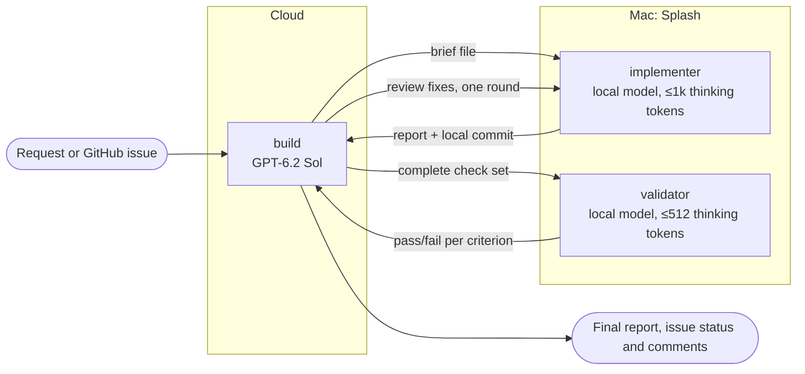

# opencode-agent-setup

**A cloud model plans and reviews; a local model on a Mac does the work.**

This repository is a native [OpenCode 2](https://opencode.ai) profile and a one-command installer for
an agent team that runs unattended on real tickets: GPT-6.2 Sol in the cloud is the orchestrator,
and a quantized open-weight model served locally by [Splash](https://github.com/incoai/splash) on
Apple silicon writes the code, the tests and the docs, then checks them. No plugin, no wrapper: just
OpenCode's own agents, permissions and variants, tuned by measurement.

On a real tvOS SwiftUI change with project rules (failing-first test, rule test plans, docs), the
profile finishes in **about 24 minutes, scores 8.5–9.5 out of 10, and uses about 10k cloud output
tokens**. Most of the tokens are generated locally, so they cost nothing.

## Why

Frontier models make the best decisions, but long agent runs spend most of their tokens on reading
files, running builds and rewriting code. Local models do that work for free, but they make poor
decisions on their own. So the profile splits the roles:

| | cloud orchestrator | local workers |
|---|---|---|
| model | GPT-6.2 Sol, high effort | Qwen3.8-Flash-Next, IQ3_S GGUF, on Splash |
| does | reads the request and project rules, investigates, runs the small experiment that settles each claim, designs stateful changes, writes briefs with numbered acceptance criteria, reviews the diff | implements one brief: failing test first, code, docs, all checks, local commit; then a separate validator re-runs everything and proves the test fails without the change |
| never | edits code, runs builds after investigating, polls running workers | decides the design, asks the user, starts subagents, touches GitHub |



Agents pass work as files (one brief, one report and a `progress.md` per task), so every decision
is reviewable afterwards and an issue comment can link to it.

## Results

One task, run unattended many times: in a tvOS SwiftUI app, find how the accent color is set and
switch it to the native system pink, following the project's rules. A correct result keeps the
asset-catalog mechanism with a single `systemPinkColor` reference and adds a test over Light/Dark ×
normal/increased contrast. Apple M5 Max, 128 GB.

| setup | runs | time | quality /10 | cloud tokens written |
|---|---|---|---|---|
| any number of generic workers, orchestrator at xhigh | 2 | 40 min | 7.5–9 | — |
| three role agents (investigator, implementer, validator) | 2 | 43 min | 8 | 8k |
| orchestrator investigates, two role agents | 4 | 28–34 min | 5–9.5 | 15–18k |
| + thinking caps on workers | 2 | 21–26 min | 9–9.5 | 17–38k |
| + "stay idle while workers run" (Q4_K_XL) | 2 | 22–25 min | 9.5 | 10–12k |
| **this profile on IQ3_S** | 4 | **20–26 min (avg 23.7)** | **8.5–9.5** | **9–13k** |
| this profile on oMLX 0.8.0, oQ3h-mtp | 2 | 30–38 min | 5–9 | 10–23k |

## What the measurements taught

Each rule in the profile is there because a run failed or wasted time without it.

- **Local generation dominates wall time.** Capping worker thinking per reply (Splash's
  `thinking_token_budget`, passed through an OpenCode variant) cut local tokens by up to 40% with no
  quality loss.
- **The cloud model should investigate, not a local one.** A local investigator was slow; letting the
  orchestrator investigate halved that phase. It also needs the rule "test the existing mechanism
  before replacing it", or it skips the experiment and rewrites working code.
- **An idle orchestrator is a cheap orchestrator.** Workers run in the background. Without an explicit
  "end your turn while a worker runs" rule, the orchestrator kept polling and doubled cloud tokens.
- **Rules in a prompt don't limit agents; permissions do.** Only role agents with `subagent`
  permission rules held the number of workers fixed.
- **Vague briefs cost hours.** A four-platform change took 72 minutes, 53 of them in one worker,
  because the brief left the state design open. Now the orchestrator designs stateful changes itself
  (types, invariants, edge cases as named tests) and splits large changes into tasks.
- **Validation has to find everything in one pass.** A short-budget validator ran out of steps before
  writing its report, and regressions surfaced one round at a time: 6.5 hours on a 21-file change.
  Now the validator writes its report first, gets 80 steps and runs the full check set once.
- **Concurrency helps only where it is safe.** With Splash at 4 concurrent requests, combined output
  rose from about 110 to 270 tokens/s and prompt caches survived. But two simulator test runs at once
  killed each other, so two workers may run together only when at most one of them builds.
- **Long sessions are not slower per step.** Splash's prompt cache keeps a step at 5–8 s and about
  80 tokens/s from 50k to 220k tokens of context; long sessions cost steps and rework instead.
- **Serving engine matters.** oMLX was about 30% slower per token than Splash here, and its memory
  guard rejected long prompts while Xcode was building.

## What's in the repository

| path | what it is |
|---|---|
| [`config/opencode.jsonc`](config/opencode.jsonc) | the profile: the Splash provider, per-agent thinking caps as variants, step limits, permissions |
| [`config/AGENTS.md`](config/AGENTS.md) | the orchestration rules every session reads: how to investigate, brief, review, split and recover |
| [`config/skills/github-tickets/SKILL.md`](config/skills/github-tickets/SKILL.md) | picks an issue from the project board, moves its Status and comments at each milestone; never closes it |
| [`install.py`](install.py) | installs and verifies everything on a Mac, standard library only |
| [`tests/`](tests) | unit tests for the installer |
| [`AGENTS.md`](AGENTS.md) | the full reference: design, every fact the profile depends on, results and the repository's own rules |

## Install

Apple silicon Mac (128 GB for this model), Homebrew and Python 3.9+.

```sh
python3 install.py --dry-run     # show what would change
python3 install.py               # packages, model, configuration, checks
opencode auth login openai       # once per Mac
```

The installer installs OpenCode 2 and Splash with Homebrew, selects the worker model in Splash and
waits until it is served (the first start downloads about 90 GB), and writes the configuration,
backing up any differing file and keeping local settings such as an `mcp` block. Then it checks
that OpenCode routes every role to its configured model, that Splash honours the thinking cap, and
that an OpenAI login exists. Exit 0 means ready, 2 means only manual steps remain, 1 is an error.

Then open a project and ask, for example, `Implement https://github.com/OWNER/REPO/issues/123`.

## Development

```sh
python3 -B -m unittest discover -s tests -p 'test_*.py'
```

Standard library only, Python 3.9 compatible, no machine-specific paths. After changing `config/`,
rerun `install.py` and repeat a real task to measure what it costs.
